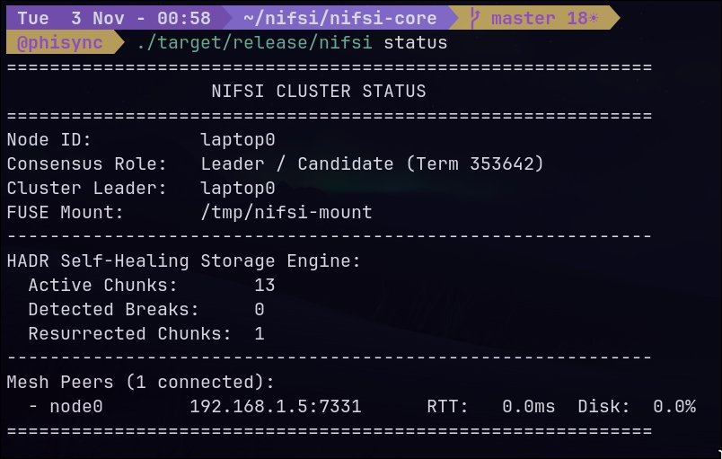
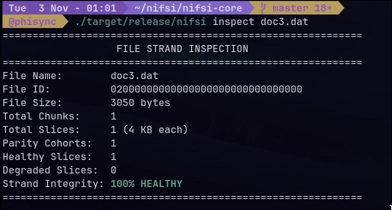
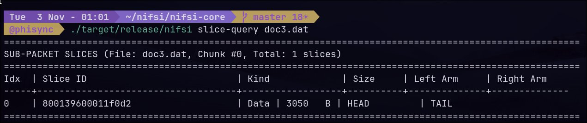
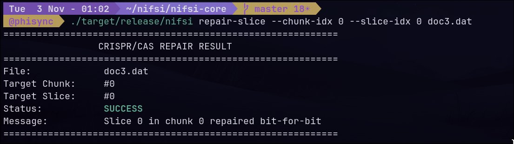

# Nifsi

[](https://github.com/phi5ic/Nifsi/blob/main/LICENSE)


Nifsi is an experimental, distributed userspace operating system layer written in Rust for Linux clusters (targeting 5 to 50 nodes). 

The goal of the project is to provide a single, coherent system view across multiple physical or virtual machines without the operational overhead of heavy container orchestration platforms or complex hypervisors. By installing a lightweight daemon (`nifsid`) on each node, machines form an encrypted peer-to-peer mesh presenting a unified FUSE filesystem, Raft-replicated metadata, and a self-healing erasure-coded storage engine.

> **Design note:** Nifsi is not a container orchestrator (like Kubernetes), a virtual machine manager, or a kernel replacement. Linux handles the physical hardware; Nifsi handles the network coordination and distributed state in userspace.

---

## Current Status & Reality Check

I am an independent systems engineer building Nifsi alongside full-time university coursework. I spend roughly 15 hours a week on this project (outside exam cycles and academic deadlines), using it as a vehicle to test distributed systems theory, coding theory, and Linux kernel interfaces against real implementations.

- **Maturity**: Pre-alpha / active research prototype.
- **Target environment**: Small, low-latency LAN clusters (home labs, edge nodes, drone swarms, research testbeds).
- **Tested setups**: Tested across 4 virtual local nodes and heterogeneous nodes (e.g., laptop + Raspberry Pi 3B+ ARM Cortex-A53 over Wi-Fi).

---

## System in Action

The Nifsi CLI (`nifsi`) provides direct visibility into cluster consensus, storage strand health, slice allocation, and localized repair.

### 1. Cluster Status & Mesh Consensus
The cluster elects temporary leaders via Raft when state replication is required. The live status displays node roles, term progression, mount points, peer round-trip latencies, and storage engine health:

```bash
nifsi status
```



### 2. File Strand & Integrity Inspection
Files stored in Nifsi are managed as strands subdivided into 4 KB slices. The `inspect` command reports file metadata, slice counts, parity cohort assignments, and bit-level health:

```bash
nifsi inspect doc3.dat
```



### 3. Sub-Packet Slice Topology
Files are tracked at granular slice boundaries. Querying slices displays internal slice identifiers, payload sizes, and linkage arms:

```bash
nifsi slice-query doc3.dat
```



### 4. Surgical Slice-Level Repair
Unlike monolithic erasure codes that pull entire multi-megabyte chunks across the network to fix localized errors, Nifsi's **HADR (Horizontal & Diagonal Parity)** storage engine repairs damaged 4 KB slices independently without reading surviving data nodes:

```bash
nifsi repair-slice --chunk-idx 0 --slice-idx 0 doc3.dat
```



---

## Core Architecture

```
┌────────────────────────────────────────────────────────┐
│                   Applications                         │
└───────────────────────────┬────────────────────────────┘
                            │ POSIX I/O
┌───────────────────────────▼────────────────────────────┐
│              FUSE Mount Layer (/nifsi/)                │
├────────────────────────────┬───────────────────────────┤
│    HADR Storage Engine     │   Metadata Consensus      │
│  - 4 KB Slice Granularity  │   - Raft Leader Election  │
│  - Horizontal + Diag XOR   │   - SQLite-backed Log     │
│  - Delta Journaling        │   - Quorum Writes         │
├────────────────────────────┴───────────────────────────┤
│            P2P Mesh Network (ChaCha20-Poly1305)        │
│              - Boids-style Swarm Discovery             │
│              - Zero-Trust Authenticated Frames         │
└────────────────────────────────────────────────────────┘
```

### 1. HADR Storage Engine
Standard XOR-based array codes (RAID-6, EVENODD, RDP) typically rebuild whole chunks when corruption occurs, causing heavy network traffic. Nifsi's prototype storage engine introduces:
- **Slice-Level Repair**: Fragments are partitioned into 4 KB slices. Horizontal and diagonal parity are calculated across slices, allowing surgical repairs of isolated bit-rot or lost packets by transferring only 16 KB over the wire instead of multi-megabyte blocks.
- **Delta Journaling**: Overwrites compute $\Delta = D^{\text{old}} \oplus D^{\text{new}}$ and update parities directly, keeping write amplification flat at **3.0×** regardless of chunk size (compared to monolithic XOR scaling up to 16,384× on 16 MB chunks).

For the full math, benchmarks, and throughput trade-offs, read the write-up: **[What I Learned Trying to Beat XOR](https://phi5ic.github.io/posts/what-i-learned-trying-to-beat-xor/)** or check [`benchmarks/`](benchmarks/).

### 2. Raft Consensus & Metadata
- Leaders are elected via Raft when consensus is strictly required (such as file creation, directory metadata changes, or membership alterations).
- Read operations and slice transfers bypass the consensus leader and stream directly between mesh peers.
- State machine entries are persisted into an embedded SQLite log store.

### 3. Encrypted P2P Mesh
- Nodes discover peers using lightweight gossip protocols.
- Node-to-node framing is encrypted and authenticated by default using **ChaCha20-Poly1305 AEAD**. Untrusted traffic is rejected before reaching the FUSE or storage subsystems.

---

## Feature Matrix (v0.1)

| Subsystem | Feature | Status |
|---|---|---|
| **Filesystem** | Distributed FUSE mount across nodes | Working |
| **Consensus** | Raft election, SQLite-backed log replication | Working |
| **Networking** | ChaCha20-Poly1305 AEAD authenticated framing | Working |
| **Discovery** | Swarm health gossip and peer discovery | Working |
| **Storage (HADR)** | 4 KB slicing, horizontal/diagonal parity, slice repair | Working prototype |
| **Storage (Delta)** | Delta journaling with constant 3.0× write amplification | Working prototype |
| **CLI** | `status`, `inspect`, `slice-query`, `repair-slice`, `join`, `leave` | Working |
| **Testing** | Virtual multi-node + Raspberry Pi 3B+ ARM cluster | Verified |
| **Process Layer** | Remote process execution (`nifsi run`) | Planned |
| **Scheduler** | Data-locality aware process scheduler | Planned |
| **Tracing** | eBPF-based userspace kernel instrumentation | Planned |

---

## Quickstart

### Prerequisites
- Linux (kernel 5.15+ recommended)
- `fuse3` / `fusermount3`
- Rust 1.85+ (crates use the 2024 edition)

### 1. Build from Source
```bash
git clone https://github.com/phi5ic/Nifsi.git
cd Nifsi
cargo build --workspace --release
cargo test --workspace
```

### 2. Run a Local 3-Node Cluster
You can simulate a multi-node cluster on a single machine by starting three daemons on distinct ports and directories:

```bash
# Terminal 1: Node 1
./target/release/nifsid --id node1 --bind 127.0.0.1:7331 \
  --data-dir /tmp/nifsi-cluster/node1/data \
  --socket /tmp/nifsi-cluster/node1.sock \
  --mount /tmp/nifsi-cluster/node1/mount \
  --peer node2=127.0.0.1:7332 --peer node3=127.0.0.1:7333

# Terminal 2: Node 2
./target/release/nifsid --id node2 --bind 127.0.0.1:7332 \
  --data-dir /tmp/nifsi-cluster/node2/data \
  --socket /tmp/nifsi-cluster/node2.sock \
  --mount /tmp/nifsi-cluster/node2/mount \
  --peer node1=127.0.0.1:7331 --peer node3=127.0.0.1:7333

# Terminal 3: Node 3
./target/release/nifsid --id node3 --bind 127.0.0.1:7333 \
  --data-dir /tmp/nifsi-cluster/node3/data \
  --socket /tmp/nifsi-cluster/node3.sock \
  --mount /tmp/nifsi-cluster/node3/mount \
  --peer node1=127.0.0.1:7331 --peer node2=127.0.0.1:7332
```

### 3. Interacting with the Cluster
```bash
# Check cluster state and peer connectivity
./target/release/nifsi --socket /tmp/nifsi-cluster/node1.sock status

# Write a file on Node 1, read it on Node 3
echo "hello nifsi" > /tmp/nifsi-cluster/node1/mount/test.txt
cat /tmp/nifsi-cluster/node3/mount/test.txt

# Inspect file slices
./target/release/nifsi --socket /tmp/nifsi-cluster/node1.sock inspect test.txt
./target/release/nifsi --socket /tmp/nifsi-cluster/node1.sock slice-query test.txt

# Trigger slice repair
./target/release/nifsi --socket /tmp/nifsi-cluster/node1.sock repair-slice --chunk-idx 0 --slice-idx 0 test.txt
```

---

## Workspace Layout

The repository is structured as a Cargo workspace:

```
Nifsi/
├── cli/          # 'nifsi' client binary (cluster control, inspection, repair)
├── daemon/       # 'nifsid' background daemon (mount coordinator, local API)
├── fs/           # FUSE driver & HADR slice-level erasure coding engine
├── mesh/         # ChaCha20-Poly1305 encrypted wire framing & peer discovery
├── raft/         # Raft state machine and SQLite log persistence
├── core/         # Shared protocol types, config structures, and primitives
└── benchmarks/   # Benchmark harness, JSON metrics, and scientific reports
```

---

## Roadmap

1. **Failure Injection Harness**: Systematic tests for Byzantine faults, bit-flips mid-write, and ungraceful kill/recovery cycles across physical switches.
2. **Hybrid Ingestion Pipeline**: Wire bulk full-stripe writes through vectorized monolithic XOR while indexing background chunks into 4 KB slices for repair.
3. **Data-Aware Scheduler**: Schedule compute tasks directly on nodes holding the target data slices to avoid network traffic.
4. **Remote Execution (`nifsi run`)**: Userspace process spawning integrated with the distributed filesystem.
5. **eBPF Instrumentation**: Kernel-level tracing for I/O latency breakdowns and syscall metrics.

---

## Benchmarks & Code Artifacts

The microbenchmarks, chaos testing scripts, and JSON results comparing Sliced HADR-v2 against Monolithic XOR and Cauchy Reed-Solomon are located in [`benchmarks/`](benchmarks/):
- Harness: `benchmarks/run_benchmark.sh` and `benchmarks/hadr_bench.rs`
- Scientific report: `benchmarks/BENCHMARK_SCIENTIFIC_REPORT.md`
- Raw results: `benchmarks/benchmark_results.json`

---

## License

Nifsi is licensed under the **GNU Affero General Public License v3.0 (AGPL-3.0)**. See [`LICENSE`](LICENSE) for details.
